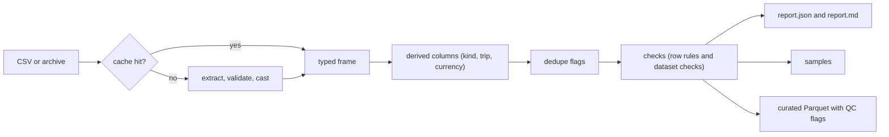

# rideshare_data_pipeline

Quality-control and outlier checks for a consumer e-receipt panel sample covering two rideshare merchants (Uber and Lyft), built on [polars](https://pola.rs/).

Every number in this README comes from a made-up synthetic fixture or is a rule threshold. The real sample is never part of the repository, and this document describes methods only.

## Contents

1. [The problem](#the-problem)
2. [Quick start](#quick-start)
3. [Data handling](#data-handling)
4. [Data dictionary](#data-dictionary)
5. [Check catalog](#check-catalog)
6. [Methodology](#methodology)
7. [Architecture and data flow](#architecture-and-data-flow)
8. [Outputs and report format](#outputs-and-report-format)
9. [Testing](#testing)
10. [Performance](#performance)
11. [Assumptions and limitations](#assumptions-and-limitations)
12. [Development](#development)
13. [Future work](#future-work)

## The problem

A data vendor parses the receipt emails that a panel of long-tenured, active consumers receives from rideshare merchants, and delivers one row per receipt: who (a hashed panelist ID), when (trip, email and ingestion times), how much (totals, tax, discounts), what (a free-text product line) and vendor delivery metadata. There is no data dictionary, so the meaning of each field has to be inferred from the data itself.

The task is to design and run practical quality-control and outlier tests on that sample and to state the assumptions behind them. This package does that in four steps: validate the file's contract (encoding, header, types), classify every receipt (a ride, a tip update, a driver payout, a pass and so on), run a catalog of row-level and dataset-level checks, and write a report plus a curated Parquet file in which every input row carries per-row QC flags. Rows are flagged, never dropped, so the consumer decides what to exclude.

## Quick start

You need [uv](https://docs.astral.sh/uv/). It installs Python 3.15 if you don't have it. These commands run as written from a checkout, on a synthetic file that the repository generates (made-up data, 294 rows, with a known set of planted problems):

```sh
uv sync --locked                                                    # .venv with the package and the dev tools
uv run python tests/fixtures/make_synthetic.py synthetic.csv        # write the synthetic input
uv run rideshare-qc run --input synthetic.csv --out reports         # run the checks
```

The command exits 1 on this input, because the fixture plants a negative ride total (an error-severity check). To run on your own file, pass its path (or a `.tar.bz2`, `.tar.gz`, `.tar.xz`, `.tar` or `.zip` archive that holds exactly one CSV) as `--input`. `python -m rideshare_data_pipeline run ...` works the same way as `rideshare-qc run ...`.

The run prints a summary, one line per check and the paths written. This is the real output of the command above (synthetic data):

```text
encoding:         UTF-8, no BOM, CRLF line endings
rows:             294
columns:          33
all-null columns: 5 (order_points, order_shipping, SKU, item_id, file_id)
constant columns: 4 (order_total_qty, item_quantity, digital_transaction, product_category)
duplicate rows:   0
wrote:            reports/synthetic.curated.parquet (78 columns)

error  PASS  header_valid                            0/1            0.0000%
error  PASS  utf8_valid                              0/1            0.0000%
error  PASS  cast_failures                           0/20           0.0000%
warn   PASS  row_count_band                          0/1           294 rows
error  PASS  required_fields                         0/294          0.0000%
warn   FAIL  id_formats                              1/294          0.3401%
error  FAIL  non_negative_total                      1/286          0.3497%
error  PASS  item_price_equals_subtotal              0/294          0.0000%
warn   FAIL  zero_fare_rides                         1/283          0.3534%
warn   FAIL  discount_within_subtotal                1/8           12.5000%
warn   FAIL  tax_within_total                        1/8           12.5000%
warn   PASS  unexplained_residual                    0/280          0.0000%
error  PASS  checksum_unique                         0/294          0.0000%
warn   FAIL  category_mismatch                       4/294          1.3605%
error  PASS  merchant_sender_consistent              0/294          0.0000%
warn   FAIL  unknown_sender                          1/294          0.3401%
error  PASS  ingestion_order                         0/294          0.0000%
error  PASS  order_before_receipt                    0/290          0.0000%
warn   FAIL  late_receipts                           1/290          0.3448%
warn   FAIL  order_before_window                     1/290          0.3448%
warn   PASS  email_after_update                      0/294          0.0000%
warn   FAIL  implausible_speed                       1/283          0.3534%
warn   FAIL  zero_trip_metrics                       1/283          0.3534%
warn   PASS  extreme_trip                            0/283          0.0000%
info   PASS  all_null_columns                        5/33          15.1515%
info   PASS  constant_columns                        4/33          12.1212%
error  PASS  duplicate_rows                          0/294          0.0000%
warn   PASS  ride_completeness                       0/282          0.0000%
info   PASS  identity_share                        263/280         93.9286%
info   PASS  receipt_kinds                           8/294          2.7211%
info   PASS  unclassified_subject_templates          0/294          0.0000%
warn   FAIL  duplicate_receipts                      6/290          2.0690%
error  PASS  dedupe_key_unique                       0/287          0.0000%
warn   FAIL  cross_panelist_duplicates               2/290          0.6897%
warn   FAIL  near_duplicate_rides                    1/285          0.3509%
warn   PASS  description_parse_coverage              0/283          0.0000%
warn   FAIL  currency_suspect_rows                   3/294          1.0204%
info   PASS  date_only_order_time                  160/290         55.1724%
warn   FAIL  fare_outlier_conditional                1/277          0.3610%
info   PASS  fare_outlier_univariate                 2/278          0.7194%

errors failed: 1  warnings failed: 15  passed: 24/40  fail-on: error  exit: 1
wrote: reports/report.json
wrote: reports/report.md
wrote: 15 sample file(s) in reports/samples
```

Each line is `severity  PASS|FAIL  check  failed/evaluated  rate`. A row rule passes while its failure rate is at most its threshold (`max_failed_rate`, 0 by default); a null never counts as a failure. Info checks always pass.

### Exit codes

| Exit status | Meaning |
|---:|---|
| 0 | Every check that gates passed. |
| 1 | An **error**-severity check failed (with `--fail-on warn`, a failed **warn** check too). Info checks never gate. `report.json`, `report.md`, the samples and the Parquet are still written. |
| 2 | Input or parse error, a bad config file (unknown key or check name, bad value, no check left enabled), invalid arguments, or the output can't be written. The reason is on stderr. **Nothing is written** when the input or config can't be read. |
| 3 | **Internal error**: an unexpected exception, i.e. a bug in this tool rather than a fault in the input or a verdict on the data. One line on stderr (`rideshare-qc: internal error: <type>: <message> (please report)`), no traceback. Ctrl-C is not caught (exit 130). |

### Command line

```text
rideshare-qc run --input PATH --out DIR [--config FILE] [--fail-on {error,warn}] [--drop-columns A,B]
                 [--cache-dir DIR] [--refresh-cache]
rideshare-qc --help | --version
```

- `--input PATH`: the CSV, or an archive holding exactly one CSV (see [Archives](#archives)).
- `--out DIR`: where everything is written (created if missing); see [Outputs and report format](#outputs-and-report-format).
- `--config FILE`: a TOML file with thresholds, severities and on/off switches (see [Configuration](#configuration)).
- `--fail-on {error,warn}`: the lowest severity whose failure exits 1. Overrides the config's `fail_on`; the default is `error`.
- `--drop-columns A,B`: input columns to leave out of the curated Parquet. By default every column and every row is kept; the derived and flag columns are never dropped. The checks run on the whole frame first, so a dropped column's flags are still correct.
- `--cache-dir DIR`: keep (and reuse) a typed Parquet copy of the input in DIR. Also read from the environment variable `RIDESHARE_QC_CACHE` when the flag is absent; with neither, no cache is used (see [Cache](#cache)).
- `--refresh-cache`: rebuild the cache entry for this input even if a valid one exists (needs a cache directory).

### Configuration

Defaults live in code (`QCConfig` in `config.py`); a TOML file overrides them. [`qc.example.toml`](qc.example.toml) lists every check with its default and is loaded by a test:

```toml
sample_limit = 20          # failing rows kept per check
fail_on = "error"          # "error" or "warn"; --fail-on overrides it
min_rows = 1               # row_count_band: fewest rows (0 = no lower bound)
# max_rows = 5000000       # row_count_band: most rows (default: no limit)

[checks.non_negative_total]
max_failed_rate = 0.01     # passes while failed / evaluated <= 0.01
severity = "warn"          # "error", "warn" or "info"
enabled = true             # false removes the check from the run and the report
```

A check with numbers of its own takes a `[checks.<name>.params]` table: `k` for the two fare-outlier checks (greater than 0; defaults 4 for `fare_outlier_conditional` and 3.5 for `fare_outlier_univariate`), `max_mph` and `min_seconds` for `implausible_speed`, and `max_miles` and `max_seconds` for `extreme_trip`.

```toml
[checks.fare_outlier_conditional.params]
k = 4.0                    # both |robust z| must exceed k; the report shows the effective k
```

Unknown keys and unknown check names are errors (exit 2), so a typo can't silently do nothing. So is a param name the check doesn't know, a param that is not greater than 0, a config that leaves no check enabled besides `cast_failures` (which can't be disabled, so it doesn't count), and `enabled = false` for `cast_failures` itself. The effective thresholds and severities are recorded in the report. A `max_failed_rate` on a dataset check (for example `duplicate_rows`) replaces its threshold and re-judges it against its measured rate.

## Data handling

This repository is public. The rules:

- **Real data is never committed**: not the raw file, extracts of it, or anything derived from it. `.gitignore` blocks the usual data and archive formats everywhere except small synthetic fixtures under `tests/fixtures/`, and the tests build their synthetic files in a temporary directory.
- **No names, no local paths, no sample figures.** The dataset is described only as a consumer e-receipt panel sample covering two rideshare merchants. The documentation explains rules and rationale and shows output from the synthetic fixture, never counts or distributions from the real sample.
- CI enforces the first two: `tools/check_no_data.py` fails the build if a tracked file is over 1 MB, if a data or archive file is tracked outside `tests/fixtures/`, if a tracked CSV outside it has the input schema's header, if any word in a tracked text file has a SHA-256 on a denylist (only the hashes are stored, so the guard does not contain the names it blocks, and it reports `path:line`, never the word), or if a file holds an absolute home-directory path. Run `uv run python tools/check_no_data.py` locally, or use it as a pre-commit hook.
- The CLI writes only to the `--out` directory you name, plus the cache directory if (and only if) you opt in. Archives are extracted to a temporary directory that is deleted when the run ends. The cache holds a typed copy of the real data, so keep it outside the repository (see [Cache](#cache)).
- Reports contain the input's base name and SHA-256, aggregate counts, and failing-row samples limited to the columns each rule chooses (hashed `user_id`, order number, times, amounts, receipt kind; no free-text subjects, and never the sender address, whose local part can be a person's). The one place subject text appears is the `unclassified_subject_templates` check, which lists at most 20 normalised templates (masks, digits, dates and weekdays replaced) of subjects no rule recognised. They still describe real data: write reports to a directory outside the repository (`.gitignore` blocks `/reports/`), and share them like the data.

## Data dictionary

The file has 33 columns and no documentation. The meanings below were inferred from the data and tested against hypotheses (for example, that the merchant tag agrees with the sender domain, and that two amounts agree wherever both exist). They are inferences, not vendor facts.

| Column | Inferred meaning | Notes |
|---|---|---|
| `merchant_name` | The vendor's merchant tag: Uber or Lyft | Agrees with the sender domain (check V1) |
| `user_id` | Hashed panelist ID (SHA-256 hex) | Receipts per panelist are very uneven: a long tail of heavy users and many with one receipt |
| `order_number` | The merchant's trip or receipt ID | Lyft: a long numeric string; Uber: a UUID. Null for driver payouts, passes and Lyft tip increases. **Not unique** (vendor upserts; see [Duplicates and dedupe](#duplicates-and-dedupe)) |
| `order_time` | Trip date and time printed on the receipt, in the trip's **local** time | Lyft has minute precision; Uber is almost always a date at midnight (time unknown) |
| `email_time` | Arrival time of the receipt email, in **UTC** (inferred) | The Lyft lag `email_time - order_time` clusters at whole-hour US offsets plus a few minutes; the rows whose order time falls after the email time come from senders east of UTC |
| `insert_time` | Vendor ingestion time of the record's first version | Can precede `email_time`: the vendor upserts versions of a receipt and keeps the first `insert_time` |
| `update_time` | Time of the record's last update | Never before `insert_time` |
| `order_total_amount` | Amount charged, including tip and fees, in the trip's **local currency** | **No currency column.** See [Currency and the USD gate](#currency-and-the-usd-gate) |
| `order_subtotal`, `item_price` | The fare before tip, tax and discounts | Equal wherever both are present (single-item receipts) |
| `order_tax` | The tax line where printed | Sparse; absent for non-US senders |
| `order_discount` | A promotion or discount line | Sparse; occasionally larger than the subtotal |
| `order_total_qty`, `item_quantity`, `digital_transaction`, `product_category` | Constant fields of a generic receipt schema | `product_category` is always `Travel`, which is wrong for food, freight, rentals and driver earnings |
| `order_points`, `order_shipping`, `SKU`, `item_id`, `file_id` | Unused fields of the generic schema | Entirely null |
| `product_description` | The ride product plus trip metrics (distance, duration), or a non-trip line | Several templates; see [Description parsing](#description-parsing) |
| `product_subtitle` | Pass or subscription terms | A parser artifact repeats the merchant name on a few rows |
| `product_reseller` | The restaurant name on food-delivery receipts | A handful of food orders are mis-tagged as rideshare |
| `order_pickup` | A vendor-coded receipt type or status (inferred) | A small integer code; one value occurs only on Lyft driver payouts. Used as one signal of the receipt kind |
| `from_domain` | The **full sender address**, despite the name | Encodes the country or city (`uber.<country>@...`, `receipts.<city>@...`); a few rows come from individual people's addresses (freight) |
| `email_subject` | The masked subject line | Templates per receipt type; `[Business]` or `[Personal]` profile tags; mail-gateway prefixes; some Spanish or Portuguese subjects. The mask's length can reveal the length of a driver's first name, which matters for the privacy work (#30) |
| `delivery_date`, `start_source_folder_date`, `end_source_folder_date`, `source_dttimestamp`, `dttimestamp` | Vendor delivery-batch metadata | The start and end folder dates agree; `update_time <= source_dttimestamp <= dttimestamp` holds |
| `checksum` | A hash of the record version | Unique per row, so it cannot find content duplicates |

### Receipt kinds

The file mixes receipt types that are not rider spend, all tagged with the category `Travel`. `parse.py` derives one kind per row from the subject template, the description line, `product_reseller`, `UF-` order numbers and `order_pickup`:

| Kind | What it is | Rider spend |
|---|---|:---:|
| `ride` | A trip receipt (also the default when no rule matches) | yes |
| `tip_update` | The updated receipt after a tip was added; supersedes the ride it amends | yes |
| `fare_correction` | An adjusted fare; supersedes the ride it amends | yes |
| `cancel_noshow` | A cancellation or no-show fee | yes |
| `payment_failed` | A failed charge | no |
| `driver_earnings` | A payout to a driver | no |
| `pass_or_credit` | A subscription, pass or credit | no |
| `micromobility` | A bike or scooter ride | no |
| `food_order` | A food delivery (wrong category) | no |
| `freight` | A freight receipt (`UF-` order number; wrong category) | no |
| `rental` | A vehicle rental (wrong category) | no |

The rules form an ordered chain, most specific first (`_rules` in `parse.py`). Mail-gateway prefixes (`(EXTERNAL SENDER)`, `{Disarmed}`) and leading bracket tags are stripped before matching, and a leading `[Business]` or `[Personal]` tag becomes `subject_profile`. A row no rule matches defaults to `ride` and is counted by `unclassified_subject_templates`. `is_rider_spend` is true for the first four kinds; the others stay in the data, flagged, and are left out of spend. A cancellation fee counts as spend under its own kind.

## Check catalog

Forty checks, each shown once here with its ID, rule, default severity and rationale. The details behind a rule (population, null handling, method) are in [Methodology](#methodology). A test keeps this table in step with the check registry: the set of names, the IDs and the default severities must match what a run reports. Severity is a default that the config can change; **info** checks report and never fail.

| ID | Check | Severity | Rule | Rationale |
|---|---|---|---|---|
| S1 | `header_valid` | error | the header is exactly the 33 expected columns, in order | a changed layout means every later check would be reading the wrong column |
| S3 | `utf8_valid` | error | the file is valid UTF-8 (BOM and line endings recorded) | mis-decoded text silently corrupts the subject and description parsing |
| S2 | `cast_failures` | error | every non-null raw value converts to its column's type | a value nulled by a failed cast would look like missing data |
| C3 | `row_count_band` | warn | `min_rows <= rows <= max_rows` (defaults 1 and no limit) | an empty or truncated delivery should not pass quietly |
| C1 | `required_fields` | error | `merchant_name`, `user_id`, `email_time`, `checksum`, `from_domain`, `email_subject` are never null | the fields every receipt must have to be attributed, dated and classified |
| S6 | `id_formats` | warn | `user_id` is 64 hex digits, `checksum` 32, a Lyft order number 18-19 digits, an Uber order number a lowercase UUID; nulls are not judged | malformed IDs break joins and the duplicate key; freight `UF-` numbers fail by design |
| A1 | `non_negative_total` | error | `order_total_amount >= 0` on rider-spend receipts | a negative ride total is a sign or parse error; refunds on non-ride receipts are not errors |
| A2 | `item_price_equals_subtotal` | error | `abs(item_price - order_subtotal) <= 0.01` where both are present | the two columns describe the same fare on single-item receipts |
| A3 | `zero_fare_rides` | warn | `order_total_amount` is not exactly 0 on ride and tip-update receipts that are not superseded | a zero fare is usually a promotion or a failed capture and distorts per-ride averages |
| A4 | `discount_within_subtotal` | warn | `order_discount <= order_subtotal + 0.01` where both are present | a discount larger than the fare points to a mis-parsed line |
| A5 | `tax_within_total` | warn | `order_tax <= order_total_amount + 0.01` where both are present | tax cannot exceed what was charged |
| A6 | `unexplained_residual` | warn | `total - (subtotal + tax - discount) <= max(20, subtotal)` on USD rider-spend ride receipts | a total far above its itemized lines hides an unlisted charge or a parse fault |
| A7 | `identity_share` | info | the share of rows where `total = subtotal + tax - discount` within 0.01, with the counts above, below and not computable | the identity holds for only a minority of rides, so it is measured, not enforced |
| U0 | `duplicate_rows` | error | no row repeats an earlier row exactly | an exact copy double counts; `checksum` normally prevents it |
| U1 | `checksum_unique` | error | `checksum` is unique | a repeated version hash means the same record was delivered twice |
| U2 | `duplicate_receipts` | warn | `(merchant_name, order_number)` is unique among receipts with an order number | repeated keys are expected upserts that the dedupe resolves, so a warning |
| U2b | `dedupe_key_unique` | error | the key is unique among rows the dedupe kept | holds by construction; guards against a dedupe bug |
| U3 | `cross_panelist_duplicates` | warn | an order key appears under one `user_id` only | the same receipt in two mailboxes counts twice in per-panelist statistics |
| U4 | `near_duplicate_rides` | warn | no two rides share user, merchant, order date, total and description under different order numbers | a re-issued receipt with a new number; flagged only, never deduped |
| K1 | `receipt_kinds` | info | every receipt is rider spend; the rows of other kinds are counted, with a merchant by kind table | shows what a naive sum would include that is not a ride |
| K2 | `unclassified_subject_templates` | info | every receipt matches a known subject or description template | the unmatched rows default to `ride`, so new templates must be visible |
| V1 | `merchant_sender_consistent` | error | an Uber receipt comes from an Uber domain; a Lyft receipt from `lyft.com`, `lyftmail.com` or a subdomain | a mismatch means the merchant tag or the parse is wrong |
| V2 | `category_mismatch` | warn | `product_category` is not `Travel` on food orders, freight, rentals or driver earnings | the generic category is wrong for these kinds and they must not read as travel |
| V3 | `unknown_sender` | warn | the sender matches a known receipt-sender pattern | an unknown sender has an unknown currency and may not be a receipt |
| CUR1 | `currency_suspect_rows` | warn | no receipt is currency-suspect: a non-US sender, a km distance, or a Spanish or Portuguese subject from a sender that is not a US one | the amount may be in local currency and must not be summed as dollars |
| T1 | `ingestion_order` | error | `insert_time <= update_time <= source_dttimestamp <= dttimestamp` where present | the vendor's own stamps must be in pipeline order |
| T2 | `order_before_receipt` | error | `date(order_time) <= date(email_time) + 1 day` | a trip cannot be dated after its receipt (local time and UTC need the one-day tolerance) |
| T3 | `late_receipts` | warn | the email date is at most 7 days after the order date | a long delay suggests a backfill or a wrong order date |
| T4 | `order_before_window` | warn | `date(order_time) >= window start - 7 days` | a trip long before the delivery window is an implausible or mis-parsed date |
| T5 | `email_after_update` | warn | `email_time <= update_time` | the vendor cannot have updated a record before the email arrived |
| T6 | `date_only_order_time` | info | per merchant, the share of `order_time` values at exactly 00:00:00.000 | midnight means "time unknown", so time-of-day checks are unsafe |
| PC1 | `description_parse_coverage` | warn | every merchant parses at least 98% of its ride rows (distance and duration both read) | the trip metrics feed the plausibility and outlier checks, so low coverage invalidates them |
| O1 | `implausible_speed` | warn | implied speed is at most `max_mph` (80) on trips of at least `min_seconds` (120 s) | a car does not travel faster; points to a wrong distance or duration |
| O2 | `zero_trip_metrics` | warn | distance and duration are not 0 when `order_total_amount > 0` | a paid ride with no distance or no time is a parse fault or a void |
| O3 | `extreme_trip` | warn | distance is at most `max_miles` (100) and duration at most `max_seconds` (10,800) | an extreme trip is an error or a rare event that deserves a look |
| O4 | `fare_outlier_conditional` | warn | on USD rides, both `abs(rz(log $/mile))` and `abs(rz(log $/minute))` exceed `k` (4) within merchant x product family | a fare off both price drivers is a real anomaly; a long trip alone is not |
| O5 | `fare_outlier_univariate` | info | `abs(rz(log total)) > k` (3.5) within merchant | context only: it shows how many flags a naive univariate rule would raise |
| S4 | `all_null_columns` | info | every column has a non-null value | an empty column is dead schema, not a defect |
| S5 | `constant_columns` | info | every column has more than one distinct non-null value | a constant column carries no information |
| C2 | `ride_completeness` | warn | among rides that are not superseded, the null rate of `order_total_amount` is at most 0.01% and of `order_number` and `order_time` at most 0.5% each | a ride without a total cannot be spend; a hard 0 would fail every run on a known blemish |

## Methodology

### Structural and completeness checks

S1, S2 and S3 guard the input contract. A bad header, invalid UTF-8 or a value that doesn't cast is an input error (exit 2, nothing written), so on a run that produced a report they are recorded as passing error results (S1 `details`: the column count and `in_order`; S3: `has_bom` and `line_ending`). The rest report and never fix. `cast_failures` can't be disabled, because it would only hide a line.

A column is **all-null** when every value is null. It is **constant** when its non-null values have exactly one distinct value, so nulls are ignored. An all-null column is reported only as all-null. A file with only a header row has no rows to judge, so it reports neither. Both checks share one aggregation. C1's `details.by_field` has the null count per column, and S6's counts each field's malformed values. C2's `n_failed` is the rides missing any of the three fields; its `metric` and `threshold` are those of the field nearest its limit, and `details` has all three.

### Input validation

Every input problem is a typed exception (all subclasses of `InputError`), exits 2 and writes nothing. The message names the offending column, line or byte. `tests/test_edge_cases.py` runs each case end to end through the CLI.

| Input | Exception | Message names |
|---|---|---|
| Empty file (0 bytes) | `InputError` | the file |
| Missing or unsupported file | `InputError` | the path or name |
| Missing, extra or duplicated header names, or a reordered header | `HeaderError` | the columns (or the first column out of order) |
| A row with too few or too many fields | `RaggedRowError` | the physical line, the expected count (33) and the count found |
| Bytes that aren't valid UTF-8 | `EncodingError` | the byte offset of the first bad byte |
| Values that don't cast (`1,234.00`, `$5`, `n/a`, `nan`, `inf`) | `CastError` | the column and its failure count |
| No CSV, several, an unsafe member (absolute path, `..`, link), a `._*` sidecar alone, a damaged archive | `ArchiveError` | the member names or the problem |

A value counts as a cast failure when it doesn't parse, when a number is not finite (`nan`, `inf`, `-inf`, `Infinity`, or a value such as `1e400` that overflows), or when a timestamp or date falls outside the years 1 to 9999. Values are never nulled silently. Cases that are not errors: a header-only file writes the reports and an empty Parquet with the right schema (`row_count_band` fails as a warning); a single row runs (every non-null column is then reported constant); a BOM, CRLF or LF line endings and quoted commas or line breaks give the same results; `1e3` is accepted as 1000.0.

**Blank lines.** A line that is empty (apart from a `\r`) is not a row: polars would read it as a row of nulls, so such rows are dropped on reading and counted (`run.blank_lines` in `report.json`, `utf8_valid`'s `details.blank_lines`, and a line in the summary when it is not 0). A blank line is reported, not an error.

**Ragged rows.** A record must have exactly 33 fields. polars pads a short row with nulls without a word and has no option to raise instead, so the check is its own. Detection is cheap and location is slow:

1. A vectorized polars pass reads each line as one string and counts the commas outside quoted segments. It is fast and has no false negatives.
2. Only when it flags a line does a quote-aware stdlib `csv` pass run over the file to find the physical line (the header is line 1; a quoted field may hold a line break, so this can differ from the record number) and the field count.

Both too few and too many fields are reported this way: `data.csv line 5: expected 33 fields, found 31`. A valid file whose quoted fields contain line breaks also takes the slow pass, because a record that spans lines can't be told from a short one by line alone; the pass then finds nothing and the run goes on. Counting separators in the byte scan itself was rejected: it needs a quote-state machine per byte, which is far too slow in pure Python.

### Duplicates and dedupe

A whole-row duplicate check can never fire here: `checksum` is unique per row and the ingestion metadata differs between versions of a receipt. The vendor upserts updated receipts and the same receipt can reach two panelists, so duplicates are found on the order key `(merchant_name, order_number)`, over rows where both are non-null (a null is not a key: recurring pass charges have no order number and are legitimate).

**Dedupe policy** (`dedupe.py`). `supersede_flags` adds a boolean `is_superseded`; **rows are never dropped**, consumers filter on the flag. Within a key group one row wins and the rest are superseded. The winner is the first of: a `tip_update` or `fare_correction` (kind priority beats time, so a tip update supersedes its ride even when the ride's email is later); the latest `email_time`; the latest `update_time`; the greatest `checksum`. Rows without a key are never superseded, and dedupe is idempotent.

**Cross-panelist copies.** The same receipt can reach two panelists' mailboxes. For panel totals the dedupe keeps one row per key, so the losing copy is superseded. `supersede_flags` also adds `is_cross_panelist_copy`, true for every row of a key group with more than one distinct non-null `user_id`. A per-panelist statistic (a panelist's spend, trips or tenure) is about what each panelist received, so it should take the non-superseded rows **plus** the superseded rows that have this flag, which attributes a shared receipt to both panelists; panel-level totals keep using the deduplicated rows only.

**Tip updates count as full final fares.** A tip update is the final version of the ride it amends, and its `order_total_amount` is the whole fare including the tip, not just the tip, so it replaces the ride's amount in spend rather than adding to it. The ride's original receipt is superseded. An `Increase Tip` stub line has no distance, which is why PC1 leaves those out.

U2 is a warning because a repeated key is expected vendor behaviour that the dedupe resolves; an error would make every real run exit 1. Its details cover the groups, the excess (superseded) rows, the excess spend and a breakdown by kind pair. Excess spend is USD rider spend only; the currency-suspect part is reported apart as `excess_spend_suspect`. U4 counts the excess rows: the first ride of a group in file order is not flagged, every later one is.

### Currency and the USD gate

The file has no currency column, yet receipts from non-US merchant senders state amounts in local currency, so a plain sum mixes dollars with pesos and other currencies. `from_domain` is the full sender address, and it carries the evidence. `sender.py` derives `sender_country` from public receipt-sender patterns (`uber.<country>@` to an ISO code, `receipts.<city>@` to its country with US as the default city; generic senders such as `noreply@` give null; an unknown `uber.<token>@` is `unknown`, treated as non-US). `currency_reason` is the first of:

1. `non_us_sender`: `sender_country` is neither `us` nor null;
2. `km_unit`: the description states kilometres. This is a reason **for every sender, US senders included**: the cautious choice, since a distance in km is evidence of a non-US trip whoever sent the receipt;
3. `foreign_language`: a Spanish or Portuguese subject from a sender that is not a US one (in practice a generic sender with no country).

`currency_suspect` is true where there is a reason. **A Spanish or Portuguese subject from a US sender is not a currency reason**: such rows state miles and cost about the same per mile as other USD rides. The language stays findable as the info column `foreign_subject` (true for any such subject), and CUR1's `details.foreign_subject` counts the tagged rows that are not suspect. Rows are flagged, never dropped, and no exchange rate is applied.

`usd_rides(frame)` (`money.py`) is **the** population for every money statistic and outlier baseline: rider spend, not superseded, not currency-suspect, with a non-null `order_total_amount`. Any check that sums or ranks amounts starts from it. Zero-total rides stay in it (they add nothing to a sum), but per-ride averages and outlier baselines use `money.positive_usd_rides` (`order_total_amount > 0`).

CUR1's details hold the counts and naive sums by reason and country (local currency, not summable as USD) and the spend waterfall. V1 and V3 never show `from_domain` in their samples. `report.md` has a "Spend" section, and `report.json` an optional `spend` object, with the waterfall: the naive total of `order_total_amount`, minus currency-suspect rows, minus non-rider-spend kinds, minus superseded duplicates, equals the clean USD rider spend, each with its row count:

| step | rows | amount |
|---|---:|---:|
| naive total of order_total_amount (all rows, mixed currencies) | 294 | 9,770.10 |
| minus currency-suspect rows (local currency) | 3 | -5,734.35 |
| minus non-rider-spend kinds | 8 | -228.82 |
| of which micromobility (excluded; not rider spend) | 1 | -4.50 |
| minus superseded duplicates | 3 | -29.36 |
| **= clean USD rider spend** | 280 | 3,777.57 |

(Synthetic fixture.) Micromobility is a sub-line of the non-rider step, not a further deduction, so the waterfall still adds up exactly. The "superseded" line counts only superseded rows that have an amount and would otherwise be USD rider spend, so it can differ from the dedupe's superseded count in the "Duplicate receipts" section (which flags any kind, in any currency, with or without an amount); the report says so.

### Arithmetic checks

`total = subtotal + tax - discount` does not hold row by row: tips, tolls and fees are not itemized, and many credits are missing from `order_discount`. It holds for only a minority of rides, so it is reported (A7), not enforced. The narrower relations that do hold are the rules.

The residual is `total - (subtotal + tax - discount)`. Nulls: A2, A4 and A5 skip a row with a null operand. A6 and A7 treat a null tax or discount as 0 and call a null total or subtotal "not computable" (never a failure). Amounts are compared in whole cents, so a 0.01 tolerance does not depend on float rounding. A6 flags only a **positive** residual (a total far above the itemized lines); a large negative one is an unlisted credit, the benign side. A1 applies to rider-spend receipts only. A3's per-merchant counts are in `details.by_field`, and A7's report section shows the breakdown. Zero-total rides are A3's, negative ones A1's, and both are left out of the outlier baselines.

### Temporal checks

They compare the receipt's timestamps with each other, on every row (superseded rows included: they describe the delivered data, not spend). A null operand is never a failure; a rule that needs two columns applies to the rows that have both. The 7-day threshold of T3 (`details.by_field.over_30_days` counts the ones more than 30 days late), T4's 7 days and T2's 1-day tolerance are constants in `checks/temporal.py`, not config keys. T4's window start is the earliest `email_time` date of the frame; T4 is a row rule whose predicate holds that aggregate, which inside the one select is a scalar, so it shares the single scan. `details.by_field.order_after_email_no_tolerance` counts T2's rows without the tolerance, kept visible as the evidence for the timezone assumption. T6's `details.by_merchant` has the date-only share per merchant. T1's per-link counts are in `details.by_field`.

The report has a "Time" section: the email window, the T2 tolerance with its no-tolerance count, the T3 counts and the date-only share per merchant. The timezone reasoning is in [Assumptions and limitations](#assumptions-and-limitations).

### Trip plausibility

Cheap physical checks on the parsed trip metrics (`checks/plausibility.py`), with no baseline. The population of O1, O2 and O3 is ride and tip-update receipts that are not superseded: the question is about the trip, not the money, so the currency does not matter (a km distance is already in miles). A null distance or duration is never a failure (null means unparsed, which is PC1's), and the speed is computed only where `duration_s > 0`, so nothing is inf or NaN. The comparisons are strict: exactly 80 mph passes. O2 leaves zero-fare rides to A3, and its `by_field` splits `zero_distance` (only), `zero_duration` (only) and `both`. O3's `by_field` counts `over_distance` and `over_duration`. They are row rules in the runner's single select, and the failing-row sample shows the receipt columns plus `distance_mi`, `duration_s` and `product_family`. The report has a "Trip plausibility" section with one row per check, its threshold and its breakdown.

### Description parsing

`product_description` states the product, distance and duration of a trip in several templates; `parse.py` reads them into four derived columns, each null on a line that is not a trip (`Increase Tip`, `Earnings`, `Subscription`, a null) and never 0 there. A trip that states zero is 0.

| Column | Type | Meaning |
|---|---|---|
| `distance_mi` | Float64 | distance in miles; kilometres are converted (x 0.621371) |
| `distance_unit` | Enum `mi`, `km` | the unit the description states (`miles` is `mi`; `kilometers` and `kilometres` are `km`) |
| `duration_s` | Int64 | duration in seconds |
| `product_family` | Enum | `uberx`, `lyft_standard`, `shared` (pool, shared, line), `express_pool`, `xl`, `black_lux` (black, lux, SUV, premier), `comfort` (select, plus, comfort), `vip`, `other` |

Templates: Lyft `Lyft fare (1.63mi, 12m 23s)` (also `45s` and `1h 2m 3s`) and `Base fare ... 7.06 mi` lines; Uber `UberX 9.93 mi | 32 min` (also `| 1 h 22 min`, `km`); older Uber `2.00 miles   00:15:14 Trip time   uberX Car`. The family comes from the product label, first match in this order: express, shared, vip, black/lux, xl, comfort, uberx, lyft; a trip with none (a Lyft `Base fare` line) is `other`.

PC1 takes the ride and tip-update rows that are not superseded and leaves out the `Increase Tip` / `Tip Increase` stub lines (compared trimmed and case-insensitively): they name no trip, so they can never carry a distance. Its metric is the **worst merchant unparsed rate** (`details.metric_label`), not `n_failed / n_evaluated`, and its details hold per-merchant `rows`, `parsed` and `coverage`, the unit counts, the family counts by merchant and the ten most common unparsed shapes (digits shown as `#`, never the text). The report's "Description parsing" section shows them.

### Outlier methodology

**Why not a z-score or a fence.** Fares are heavy-tailed, roughly log-normal, and grow with distance and product. A raw z-score or a Tukey fence on the fare flags a few percent of rows, and nearly all of the high flags have a perfectly normal price per mile: they are simply long trips. The checks therefore score within a **segment**, on a **log scale** with a **robust** spread, and **conditional on the price drivers** (`checks/outliers.py`):

- **Segmentation.** Scores are computed within merchant x product family (an UberX and a Black car have different baselines). A group with fewer than `MIN_GROUP` (30) values gets no score, because a spread estimated from fewer is unstable.
- **Log-scale robust z.** `robust_z(expr, by)` is `(x - median) / (1.4826 * MAD)` of `log(x)`, with both taken `.over(by)` (`MAD = median(|x - median|)`; 1.4826 makes it match a standard deviation under a normal). The median and MAD are not moved by the heavy tail, which is the point. The score is null, never infinite, when a group's MAD is 0, and `log_positive` takes the log only where the value is positive, so a zero or negative input has no score and is never flagged.
- **Conditional $/mile and $/minute.** O4 flags a ride only when its price per mile **and** its price per minute are both extreme. A long trip (high fare, ordinary $/mile) is not flagged, nor is a trip that is merely fast or slow (implausible speed is O1's). The population is rides with `distance_mi >= 0.5`, `duration_s >= 60` and a product family. The sample shows the receipt columns plus `distance_mi`, `duration_s`, `product_family`, the two prices and the two scores, the most extreme first.
- **O5 as context.** The univariate rule on the total flags mostly long, legitimate trips. It is info, never fails, and is there so the report can contrast it with O4.
- **Population.** Both use `money.positive_usd_rides` (USD rider spend, not superseded, not currency-suspect, total > 0), restricted to the kinds `ride` and `tip_update`. Zero totals are A3's and negative ones A1's.
- **`k` is a review budget, not a false-positive rate.** It sets how many rows you are willing to look at. The report shows the flag rate at the configured `k` and a table at k = 3, 3.5, 4 and 5 computed in the same pass; both checks share one scoring pass.
- **No machine learning.** An isolation forest was tried and rejected: it flagged mostly different rows, and it gives no reason to read for any flag, while a log-scale robust z says exactly why a row was flagged (which price, how far, in which segment). With labelled anomalies a learned model could be compared; without them the explainable rule is the better trade.

The report has an "Outliers" section: `k` and the flag rate, the k table, the direction split (both prices high, both low, mixed), the top segments, the median $/mile and $/minute per product family and a method note. This is the section for the synthetic fixture:

```text
## Outliers

**O4, conditional fare outliers (warn):** k = 4, flagged 1 of 277 eligible rides (flag rate 0.3610%); 277 were scored (a segment under 30 rows, or with no spread, is not).

| k | flagged | rate |
|---:|---:|---:|
| 3 | 1 | 0.3610% |
| 4 | 1 | 0.3610% |
| 5 | 1 | 0.3610% |

| direction | flagged |
|---|---:|
| high | 1 |
| low | 0 |
| mixed | 0 |

| product family | rides | median $/mile | median $/minute |
|---|---:|---:|---:|
| uberx | 148 | 2.22 | 0.83 |
| lyft_standard | 129 | 2.25 | 0.84 |
```

(Trimmed: the k = 3.5 row and the segment tables are left out.)

## Architecture and data flow



1. **Archive to CSV.** An archive is streamed to a temporary file (see [Archives](#archives)).
2. **Cache.** With a cache directory, a hit skips extraction, validation and casting (see [Cache](#cache)).
3. **Typed frame.** The CSV is read as text, the header and UTF-8 are validated, ragged rows are looked for, and the columns are cast to their types while failed casts are counted. Any input fault ends the run with exit 2 before a check runs.
4. **Derived columns.** The receipt kind, subject profile, rider-spend flag, sender country, currency reason, and distance, duration, unit and product family are computed once per run (`parse.py`, `sender.py`).
5. **Dedupe.** `supersede_flags` adds `is_superseded` and `is_cross_panelist_copy` (`dedupe.py`). Rows are never dropped.
6. **Checks.** Every row rule is evaluated once into a narrow boolean table that both the counts and the curated flags read, then the dataset checks run. Row rules and dataset checks overlap on two threads, and the samples of failing rules are collected in one batch.
7. **Outputs.** The report, the samples and the curated Parquet are written atomically.

Package layout:

```text
src/rideshare_data_pipeline/
  __init__.py         __version__, read from the package metadata
  __main__.py         python -m rideshare_data_pipeline
  cli.py              the rideshare-qc command (argparse, `run` subcommand): summary, reports, curated output, exit codes
  config.py           QCConfig and CheckOverride (with per-check params), TOML loading, KNOWN_CHECKS
  curated.py          the curated dataset: curated_schema (the column contract), row_flags, write_curated (sink_parquet)
  dedupe.py           the dedupe policy: supersede_flags (is_superseded, is_cross_panelist_copy)
  parse.py            derived columns as pl.Expr factories: receipt kind, subject profile, rider-spend flag, currency reason, distance, duration, unit, product family
  sender.py           sender_country and the known-sender patterns (from_domain is the full sender address)
  money.py            usd_rides, positive_usd_rides (the population of every money statistic) and the spend waterfall
  report.py           report.json and report.md rendering, samples/<check>.parquet, exit-code policy
  report.schema.json  JSON Schema for report.json (package data)
  schema.py           the 33 expected columns, the raw all-String schema, the casts and their formats
  cache.py            the opt-in Parquet cache: typed frame, derived columns, index, atomic writes, fingerprints
  io.py               archive extraction, header and UTF-8 validation, the raw byte scan, ragged-row detection, typed reading with cast-failure counts
  checks/
    __init__.py       the registry (default_rules, default_dataset_checks) and the runner
    model.py          Severity, CheckResult, RowRule, DatasetCheck
    structural.py     S1-S6, C1-C3, duplicate rows
    arithmetic.py     A1-A7
    temporal.py       T1-T6
    uniqueness.py     U1, U2, U2b, U3, U4
    kinds.py          K1, K2, V2
    parsing.py        PC1
    plausibility.py   O1-O3
    outliers.py       robust_z, O4 and O5 (one shared scoring pass)
    currency.py       CUR1, V1, V3
tools/check_no_data.py   the committed-data, name and local-path guard
tests/                   see Testing
```

Importing the package doesn't import polars. The modules use PEP 810 `lazy import`, so `rideshare-qc --help` returns at once.

### Archives

An archive (`.tar`, `.tar.gz`, `.tar.bz2`, `.tar.xz` or `.zip`) must hold exactly one CSV. Only that member is extracted, streamed to `data.csv` in a temporary directory that is deleted when the run ends, so no member name ever reaches the file system and nothing else in the archive is written.

- Directories and macOS AppleDouble sidecars (`._*`, also under `__MACOSX/`) are ignored.
- No CSV, or more than one, raises `ArchiveError` (exit 2), and the message lists the members (at most 20, then "and N more").
- The CSV member is rejected if it is a symlink, a hardlink or any non-regular file, or if its name is absolute or has a `..` component.
- A truncated or corrupt archive, or an encrypted zip member, is also an `ArchiveError` (never a crash).
- Error messages about the CSV name the member's path inside the archive, not the temporary file.
- A tar is read in one sequential pass (a listing of a compressed tar means decompressing it, and seeking back would decompress it again).

### Cache

Decompressing a large bz2 archive takes tens of seconds per run. With a cache directory, the first run on an input saves the validated, typed frame as Parquet and later runs read that instead. It is opt-in: without `--cache-dir` (or `RIDESHARE_QC_CACHE`) nothing is cached and nothing is written but `--out`. The flag wins over the variable; an empty variable means no cache.

```text
<cache>/<sha256 of the input file as given>/data.parquet     the typed frame (zstd)
<cache>/<sha256 of the input file as given>/derived.parquet  the derived and dedupe-flag columns only (zstd)
<cache>/<sha256 of the input file as given>/meta.json        format version, tool version, schema fingerprint,
                                                             input facts, the CSV member's facts, row count,
                                                             and the derived columns' fingerprint and row count
<cache>/index.json                                           resolved path -> size, mtime_ns, sha256
```

- **Validity.** An entry is used only if its format version and schema fingerprint match. The fingerprint hashes the 33 column names, the dtypes and the timestamp formats, so a schema change invalidates old entries and a release that leaves it alone does not. Anything else wrong with an entry (bad JSON, unreadable Parquet, a row count that disagrees) is a warning on stderr and a rebuild.
- **Derived columns.** `derived.parquet` holds the columns the derivation and the dedupe add. Their key is a *derivation fingerprint*: a SHA-256 of the exact source text of `parse.py`, `sender.py` and `dedupe.py` plus the tool version and the polars version. This is deliberately stricter than the typed frame's key: editing the derivation logic changes the fingerprint on its own, with no constant to remember to bump, so stale derived columns can never be served. A test checks that the hashed modules cover everything those modules import from the package. On a mismatch the typed entry is still used and the derived columns are recomputed and rewritten.
- **Fast lookup.** The input is statted and looked up in `index.json`. If the path, size and mtime match and the entry is valid, the input is not read at all. Otherwise the input is hashed, which still finds an entry for a touched or copied file with the same bytes; failing that the run takes the normal path and writes the entry. The trade-off: an in-place edit that keeps both the size and the mtime would be missed. Use `--refresh-cache` to rebuild regardless.
- **Only validated data is cached.** A run that fails with an input error writes no entry. Writes are atomic (a temporary directory, then a rename), so a crash or a concurrent run never leaves a half-written entry. A cache directory that can't be written is a warning; caching never fails a run.
- **Same results.** The report is the same as an uncached run's apart from the timings and `run.cache` (`hit`, `miss` or `off`).
- The same data given as a CSV and as an archive gives two entries (the key is the file as given). The cache holds real data, not a summary: keep it outside the repository and delete it when you are done.

## Outputs and report format

Every file the run writes is written to a temporary name beside its destination and then renamed into place, so a file is either the previous one or the new one and an interrupted run never leaves a partial file. The run deletes nothing in `--out` except the previous `samples/*.parquet`: **`--out` may hold outputs of other runs**, and the report's `outputs` object lists the files that belong to this run. Use a fresh directory per input for a clean folder.

```text
reports/
  report.json                  machine-readable results
  report.md                    the human-readable report
  samples/<check>.parquet      the failing rows of each failed check (at most sample_limit)
  <input stem>.curated.parquet every input row with derived columns and QC flags
```

### report.json

`report.json` is documented by the JSON Schema (draft 2020-12) in [`src/rideshare_data_pipeline/report.schema.json`](src/rideshare_data_pipeline/report.schema.json), which a test validates a real run against. All numbers are finite, so the file is strict JSON.

```text
{"schema_version": 1,
 "run": {tool_version, input_name (base name), input_sha256, input_size_bytes, bom, line_ending,
         member (null, or for an archive: name, sha256, size_bytes, has_bom, line_ending),
         rows, panelists (distinct user_id), window {start, end} (email_time, naive ISO: UTC assumed, no offset), started, finished,
         elapsed_seconds, cache (hit|miss|off), blank_lines (optional),
         config {fail_on, sample_limit, checks {<name>: {threshold, severity}}}},
 "summary": {errors_failed, warnings_failed, info, passed, total},
 "composition": {rows, merchants, kinds: [{kind, rider_spend, total, by_merchant}]}  (optional),
 "spend": {naive_total, currency_suspect, non_rider_spend, superseded, clean_usd_rider_spend,
           micromobility (a sub-line of non_rider_spend), suspect_rider_spend: {rows, amount}, note}  (optional),
 "checks": [{name, check_id, category, severity, passed, metric, threshold, n_failed, n_evaluated,
             predicate, details, sample_file (relative path or null)}],
 "outputs": {parquet, curated ({name, rows, columns} or null), samples [relative paths]},
 "exit_code": 0 | 1}   (2 and 3 are never written: those runs have no report)
```

### report.md

`report.md` has a title with the input name and the first 12 characters of its SHA-256, a one-line run summary, the counts, a table of every check (sorted by severity, failures first) with its failed count, rate, threshold and rule, then sections for the composition by receipt kind, duplicate receipts, spend, arithmetic, description parsing, time, outliers, trip plausibility, the column profile, the curated dataset and the failing-row samples. The start of the report for the synthetic fixture (trimmed):

```text
# QC report: synthetic.csv (157ce584f01e)

rows 294 · panelists 36 · window 2019-03-01T15:11:32..2019-05-30T06:03:56

## Summary

errors failed: 1 · warnings failed: 15 · info: 7 · passed: 24/40 · exit code 1

| check | severity | status | failed | rate | threshold | rule |
|---|---|---|---:|---:|---:|---|
| non_negative_total | error | FAIL | 1 | 0.3497% | 0 | order_total_amount >= 0 on rider-spend receipts |
| header_valid | error | PASS | 0 | 0.0000% | 0 | the header is the 33 columns, in order |
...
| id_formats | warn | FAIL | 1 | 0.3401% | 0 | user_id is 64 hex digits, checksum 32; a Lyft order number is 18-19 digits, ... |
| zero_fare_rides | warn | FAIL | 1 | 0.3534% | 0 | order_total_amount is not exactly 0 on ride and tip-update receipts (...) |
...

## Composition by receipt kind

| kind | rider spend | Lyft | Uber | total |
|---|---|---:|---:|---:|
| ride | yes | 130 | 155 | 285 |
| tip_update | yes | 0 | 1 | 1 |
...
| **total** |  | 131 | 163 | 294 |

## Duplicate receipts

3 order keys repeat, in 6 rows. The dedupe flags 3 of them as superseded (rows are never dropped); ...
```

### Curated dataset

`<input stem>.curated.parquet` (zstd) is the dataset to work from: a typed, strict superset of the delivered file. **Every input row is kept**; the dedupe policy is the `is_superseded` flag, not a deletion, so there is no option to drop duplicates: consumers filter on flags. It is written by a lazy plan (one `with_columns`, then `sink_parquet`), so the typed frame is not copied to write it. The contract is `curated.curated_schema(enabled_checks)`, asserted against the written file in the tests.

Columns, in this order:

| Group | Columns | Type | Meaning |
|---|---|---|---|
| Input | the 33 columns of the file, in file order | as `schema.py` casts them | the typed values; all-null and constant columns are kept and only reported |
| Derived | `receipt_kind` | Enum | the receipt kind (see [Receipt kinds](#receipt-kinds)) |
| | `subject_profile` | String | `business`, `personal` or null, from the subject's leading tag |
| | `subject_unclassified` | Boolean | no kind rule matched, so `receipt_kind` defaulted to `ride` |
| | `is_rider_spend` | Boolean | the kind is rider spend |
| | `sender_country` | String | country of the sender, or null |
| | `currency_reason` | Enum | why the amount may not be USD (`non_us_sender`, `km_unit`, `foreign_language`), else null |
| | `currency_suspect` | Boolean | `currency_reason` is set |
| | `foreign_subject` | Boolean | Spanish or Portuguese subject (an info tag; not a reason on its own) |
| | `distance_mi`, `distance_unit`, `duration_s`, `product_family` | Float64, Enum, Int64, Enum | the trip, parsed from the description (see [Description parsing](#description-parsing)) |
| Dedupe | `is_superseded`, `is_cross_panelist_copy` | Boolean | a later version of the receipt supersedes this row; the key was seen under more than one `user_id` |
| Spend | `is_usd_rider_spend` | Boolean | the row counts toward clean USD rider spend: rider spend, not currency-suspect, not superseded, with an amount (exactly `money.usd_rides`) |
| Check flags | `qc_<check name>` | Boolean | **True means the row fails that check** (never null), one column per row-flagged check |
| Severity | `qc_error`, `qc_warn` | Boolean | the row fails at least one error- (warn-) severity flag, severities as configured; per row, so they ignore `max_failed_rate` (see below) |
| Names | `qc_flags` | List(String) | the names of the checks the row fails, in report order; an empty list, never null, on a clean row |

**Which checks have a flag.** Every row rule (its predicate, ANDed with `applies_to`, a null counting as not failed: the runner's own rule, so the column sums to the check's `n_failed`), plus the dataset checks that can point at rows: `duplicate_rows` (every exact copy after the first), `duplicate_receipts` (every row of a repeated key), `cross_panelist_duplicates` (= `is_cross_panelist_copy`), `near_duplicate_rides` (the excess rows), `currency_suspect_rows` (= `currency_suspect`), `description_parse_coverage` (the unparsed rows of PC1's population) and `fare_outlier_conditional` (O4's rows, from the same cached scores). Dataset-level findings have no column: S1, S2, S3, `row_count_band`, S4, S5, K1, K2, A7, T6, `fare_outlier_univariate`, `dedupe_key_unique` and `ride_completeness`. A check that is disabled in the config has no column. The invariant `sum(qc_<name>) == n_failed` is tested for every flag.

**Flags are per row; pass or fail is per rate.** A `qc_<check>` flag means *this row breaks the rule*. Whether the check passes is a different question, about the failure *rate* against the check's `max_failed_rate`. So with a loosened threshold a check can PASS in the report while its flag is still True on the failing rows, and `qc_error` and `qc_warn` follow the flags, not the verdicts: a row of a check the report calls passing can still be `qc_error`, and `~qc_error` excludes it. Filter on the flags to drop every row that breaks a rule, and read the report for whether the dataset as a whole is acceptable.

**Filter recipes.** These run as written on the synthetic output above (`reports/synthetic.curated.parquet`); use your own file's path otherwise:

```python
import polars as pl

df = pl.scan_parquet("reports/synthetic.curated.parquet")
# clean USD rider spend
spend = df.filter(pl.col("is_usd_rider_spend"))
# the warn-severity review queue
review = df.filter(pl.col("qc_warn"))
# no error or warn flag
clean = df.filter(~pl.col("qc_error") & ~pl.col("qc_warn"))
# one check by name
outliers = df.filter(pl.col("qc_flags").list.contains("fare_outlier_conditional"))
```

On the synthetic fixture these select 280, 21, 272 and 1 rows. `is_usd_rider_spend` already excludes superseded duplicates, so summing `order_total_amount` over its rows gives the report's clean USD rider spend exactly (3,777.57 here).

## Testing

```sh
uv run pytest                    # the whole suite; the real-data tests are skipped
uv run pytest -m slow -s         # only the opt-in real-data run (needs RIDESHARE_QC_DATA)
```

- **Synthetic fixtures.** `tests/fixtures/make_synthetic.py` is a seeded generator of about 300 made-up receipts in the real 33-column layout, with one small injection block per known data issue (duplicates, tip updates, driver payouts, food orders, a bike, freight, a non-US sender, date-only times, an implausible speed, a 10x fare and so on) on top of a clean baseline. Its `MANIFEST` gives the expected `n_failed` of every check, and `tests/test_e2e_synthetic.py` runs the whole CLI and compares each check with it, so a new check fails the suite until its expected count is decided. Other tests build small files in a temporary directory with `tests/synthetic.py`.
- **The `slow` marker.** `tests/test_real_data.py` runs only when `RIDESHARE_QC_DATA` names a local file and is skipped otherwise (CI never sets it). It runs the file three times in fresh child processes (no cache, an empty cache, a warm cache), prints a table of wall time and peak memory, and asserts only loose properties: completion, a row count above a million, rates under loose bounds, and the time budgets. It never asserts a real value.
- **`RIDESHARE_QC_DATA`** is the path to a local CSV or archive for that test. It is read from the environment only and never written to a file in the repository.
- **`RIDESHARE_QC_TIME_SCALE`** (default 1.0) stretches both time budgets on a busy or slower machine; for example `RIDESHARE_QC_TIME_SCALE=1.5` allows 15 s and 4.5 s instead of 10 s and 3 s.

  ```sh
  RIDESHARE_QC_DATA=/path/to/receipts.csv RIDESHARE_QC_TIME_SCALE=1.5 uv run pytest -m slow -s
  ```
- **Never commit data.** The `.gitignore` blocks data and archive formats outside `tests/fixtures/`, and the data guard (`tools/check_no_data.py`, run in CI's lint job and tested in `tests/test_check_no_data.py`) fails on large files, data files, a CSV with the input header, hashed denylisted words and home-directory paths; see [Data handling](#data-handling).
- **README tests.** `tests/test_readme.py` keeps this document honest: the check catalog's names, IDs and severities must match the registry, every CLI flag in the README must exist in `rideshare-qc run --help`, the quick-start command must run on the synthetic fixture, `qc.example.toml` must load and the table-of-contents links must resolve.

## Performance

The pipeline is vectorized end to end. As a guide, on an 8-core laptop a ~2M-row, ~0.9 GB CSV runs in about 6 s from the CSV, and about 2 to 3 s when the typed frame and the derived columns come from the cache. Peak memory is a few GB. The synthetic fixture runs in well under a second.

What makes it fast:

- **One pass over the bytes.** UTF-8 validation, the SHA-256, the line-ending and blank-line scan run in one chunked pass that copies nothing and hashes on a worker thread.
- **One parse.** The CSV is parsed once; the typed columns and the per-column cast-failure flags come out of one lazy query (a `CastError` is still raised before anything is written). The ragged-row scan and the parse run on threads while the byte scan runs, and their results are judged in a fixed order.
- **Each row rule is evaluated once** into a narrow bit-packed boolean table that both the counts and the curated flags read. Disabled dataset checks are dropped before they run, and the constant-column and exact-duplicate checks use cheaper scans that give exactly the same answer.
- **Derived columns are cached** next to the typed frame (see [Cache](#cache)).
- **A lazy Parquet sink** writes the curated dataset without copying the frame.

A hit on the cache skips the byte scan and the parse. The opt-in slow test asserts a budget of 10 s from the CSV and 3 s from a warm cache on an otherwise idle laptop (stretch it with `RIDESHARE_QC_TIME_SCALE`; see [Testing](#testing)).

## Assumptions and limitations

**Local time versus UTC.** `order_time` is the trip's local time (the rider's wall clock) and `email_time` is UTC. The evidence: the Lyft lag `email_time - order_time` clusters at whole-hour US offsets plus a few minutes for the receipt, and every row whose `order_time` is after its `email_time` comes from a sender east of UTC. The two columns are not on one clock, so the checks compare dates, not instants, and never a time of day. This is an inference from the data, not a vendor statement.

**The 1-day tolerance on T2.** A trip on the 12th in UTC+10 can be on the 11th in UTC when its receipt is sent, so the UTC date of the receipt may be one day before the local order date and no more (offsets span at most 14 h). Without the tolerance a few real rows fail; with it none do. The report keeps the no-tolerance count visible, as the evidence for the assumption.

**Date-only Uber `order_time`.** Uber `order_time` is a date at midnight on nearly every row: the time of day was not recorded. Midnight here means "time unknown", which a polars `Datetime` cannot tell from a real 00:00:00.000, so T6 reports the share (an info check) and no check relies on the time of day.

**No currency column.** Amounts are in the trip's local currency with no indicator. Rows with evidence of a non-US currency (sender country, a km distance, a non-US-sender foreign-language subject) are **flagged and excluded** from USD spend and baselines; no exchange rate is applied, and amounts from US senders are assumed to be USD. Evidence is indirect, so a non-US trip sent from a US sender would be missed.

**Vendor upserts.** The vendor upserts receipts: an updated receipt (a tip added to a ride) is a new row that keeps the first version's `insert_time`. So `insert_time` can precede `email_time`, and that is normal. T1 orders only the vendor's own stamps and never involves `email_time`; T5 flags the opposite oddity, an email after the vendor's last update.

**Tip updates are full fares.** A `tip_update` supersedes its ride and carries the whole final fare, so spend uses it instead of adding to the ride.

**Micromobility is excluded.** Bike and scooter receipts are not rider spend. They stay in the data, flagged, and have their own line in the spend waterfall.

**Cross-panelist copies.** One receipt can arrive in two panelists' mailboxes. Panel totals keep one copy; per-panelist statistics should add the superseded copy back to the second panelist (`is_cross_panelist_copy`).

**Rideshare-only coverage.** The sample holds receipts from two rideshare merchants only. The panel is described as long-tenured and active, but activity across all merchants is not observable here, so the active-user definition can't be verified from this file. A panelist's silence may mean a quiet panelist, or a rideshare-free one.

**Parser-dependent fields.** The trip distance, duration and product family come from parsing free text with templates that were inferred from the data; the receipt kind comes from subject and description rules. A new template shows up as a drop in PC1's coverage or in K2's unmatched count, not as an error, and a mis-parse of the vendor's own fields (the amounts, the times) is outside what these checks can see.

**Other limits.** The checks are thresholds on a single sample, so a value that passes is not proven correct. The row rules are stateless per row apart from the dedupe and the outlier baselines. `from_domain` patterns come from public receipt-sender conventions and need extending for new senders (V3 reports them).

## Development

```sh
uv sync --locked                 # create .venv from the lockfile
uv lock --check                  # the lockfile is up to date
uv run ruff check .              # lint
uv run ruff format --check .     # format (use `ruff format .` to fix)
uv run mypy .                    # type-check src, tests and tools (strict)
uv run pytest -q                 # tests
uv run python tools/check_no_data.py   # the data, name and path guard
uv build                         # sdist and wheel in dist/
```

**CI** (`.github/workflows/ci.yml`) runs on every push to `main`, every pull request (stacked PRs included) and manually. Four jobs run in parallel: *lint* (lockfile check, ruff and the data guard), *format*, *typecheck* (mypy strict) and *test* (pytest). Then *build* makes the wheel and sdist, smoke-tests the wheel in an isolated environment, checks the sdist holds the tests, tools, `qc.example.toml` and `uv.lock`, and runs the **built wheel** end to end on the synthetic fixture (it must exit 1, and `report.json` must validate against the shipped schema). Actions are pinned by commit SHA.

**Release and PyPI gating.** Pushing a `v*` tag runs *release*, which checks that the tag equals the project version in `pyproject.toml` (tag `v0.1` for version `0.1`) and creates a GitHub Release with the built files. *Publish to PyPI* runs after that only if the repository variable `PUBLISH_TO_PYPI` is `true`; it uses PyPI trusted publishing (an OIDC token, no stored API token) from the protected `pypi` environment. Nothing publishes until that variable is set after the one-time PyPI setup described in the workflow file.

## Future work

- **FX conversion by trip date.** Convert flagged local-currency amounts to USD with the rate on the trip date, so those rows can join the spend and baselines instead of being excluded.
- **A vendor feedback loop.** Send the flagged rows (with their check names) back to the vendor, record what was a vendor fault and what was real behaviour, and use the answers to tighten or relax thresholds.
- **A labelled anomaly set.** Have a sample of flagged and unflagged rows labelled by hand, so the precision and recall of each check, and of `k`, can be measured instead of chosen as a review budget. It would also allow a fair comparison with a learned model.
- **P2 issues**, tracked on GitHub:
  - #26 per-panelist behaviour (spend, trips and tenure distributions, using the cross-panelist rule above);
  - #27 seasonality-aware volume and spend anomalies;
  - #28 panel coverage and composition;
  - #29 drift between delivery batches;
  - #30 privacy normalisation (for example the subject mask that reveals a name's length);
  - #31 a stakeholder summary.

## License

GNU General Public License v3.0 (`GPL-3.0-only`). See [LICENSE](LICENSE).
